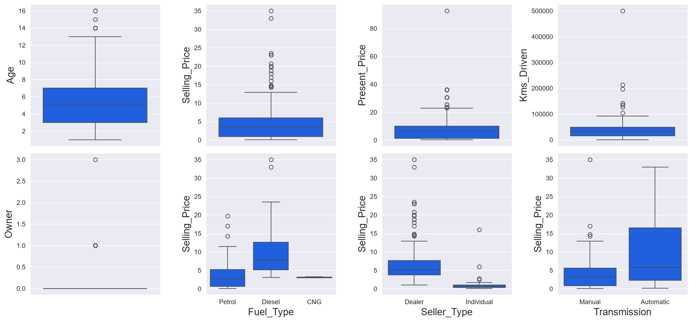
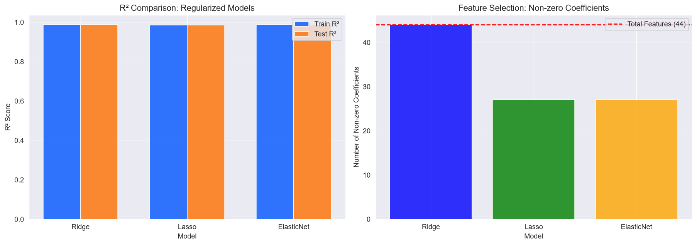
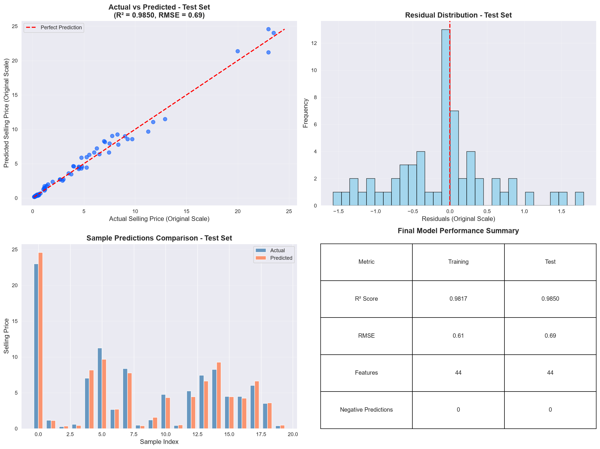

# Vehicle Price Prediction

A Python course project exploring used-car prices through data analysis and regression.

## What this project covers

- Inspecting data quality, missing values, duplicate rows and potential outliers.
- Visualizing price distributions, categorical effects and feature relationships.
- Encoding categorical variables and applying Box-Cox transformations.
- Comparing linear and polynomial regression with Ridge, Lasso and Elastic Net.
- Examining residuals and the effect of multicollinearity-based feature removal.

The notebook preserves the original exploratory workflow, with outputs cleared and personal metadata removed for this public edition.

## Run

Use Python 3.12. From this directory:

```bash
python -m venv .venv
# Activate .venv using the command for your operating system.
python -m pip install -r requirements.txt
python -m jupyter lab main.ipynb
```

Run the notebook from top to bottom. The first cell that imports libraries downloads the dataset and requires internet access. The dataset provider may require sign-in or acceptance of its own access conditions.

## Data

Source: [Vehicle dataset on Kaggle](https://www.kaggle.com/datasets/nehalbirla/vehicle-dataset-from-cardekho), downloaded with `kagglehub` using `nehalbirla/vehicle-dataset-from-cardekho`. The analysis reads `car data.csv`. Raw data is not redistributed in this repository; consult the source for its terms and provenance.

## Fresh execution snapshot

All 32 code cells completed sequentially on 2026-10-20. The original-scale test R² was **0.9850** and test RMSE was **0.6920**, subject to the evaluation limitations below. Some regularized fits emitted convergence warnings; see [execution details](VALIDATION.md).







## Interpretation and limitations

This is an exploratory learning project. It reuses a test split while comparing models, makes some cleaning choices before splitting, and applies cross-validation after training-partition preprocessing. These choices can bias the reported estimates. A stronger follow-up would use an untouched final holdout and fit preprocessing within every cross-validation fold.

R² measures explained variation and is not classification accuracy. Scores on the transformed target and the original target have different interpretations. This notebook is not a production valuation service.

## Repository contents

- `main.ipynb`: the analysis, with explanation and plotting code.
- `requirements.txt`: packages needed to open and run the notebook.
- `VALIDATION.md`: execution status for this public edition.
- `results/` (when available): selected plots produced by a fresh execution.

## Credits

Prepared from a course project for portfolio presentation. Dataset credit belongs to its original providers. This repository does not claim ownership of the dataset.
